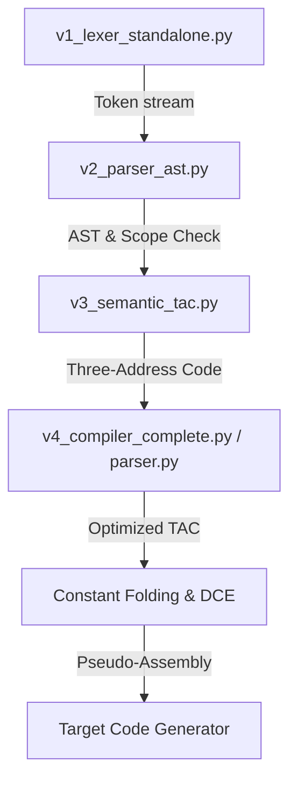

# Compiler Construction (CC) Project

A fully featured, multi-phase compiler for a subset of the C programming language, developed using Python and the **PLY (Python Lex-Yacc)** library. The project demonstrates the entire compilation pipeline, progressing from lexical analysis up to constant folding optimizations and target code (pseudo-assembly) generation.

---

## 📂 Project Structure & Versioning

The codebase is organized to show the step-by-step progress of building the compiler. It features the **active compiler files** at the root level and **evolutionary versions** representing each major development milestone.

### 🚀 Active Compiler Files (Root)
* **[lexer.py](file:///Users/nikunjgupta/Downloads/PROJECTS/CC%20project%20code/lexer.py)**: The active Lexical Analyzer using PLY. Tokens include keywords, identifiers, types, numeric constants, comments, and delimiters.
* **[parser.py](file:///Users/nikunjgupta/Downloads/PROJECTS/CC%20project%20code/parser.py)**: The complete compilation driver. Combines Lexing, Parsing, Abstract Syntax Tree (AST) construction, Scope-based Semantic Analysis, Three-Address Code (TAC) generation, Constant Folding with Dead Code Elimination, and Pseudo-Assembly Target Code Generation.
* **[input.c](file:///Users/nikunjgupta/Downloads/PROJECTS/CC%20project%20code/input.c)**: The primary test file containing nested blocks, arithmetic/relational operations, loops, and condition checks.
* **[inp.c](file:///Users/nikunjgupta/Downloads/PROJECTS/CC%20project%20code/inp.c)**: A shorter test script for targeted checks.
* **[explanations.txt](file:///Users/nikunjgupta/Downloads/PROJECTS/CC%20project%20code/explanations.txt)**: Reference guide explaining the optimization examples and virtual register-based instruction set.

### 📈 Evolution Versions (Single self-contained progression files)
* **[v1_lexer_standalone.py](file:///Users/nikunjgupta/Downloads/PROJECTS/CC%20project%20code/v1_lexer_standalone.py)**: **Phase 1: Lexical Analysis**. A standalone token scanner that processes source files and prints a table of token lexemes, types, and line numbers. Handles standard C symbols, keywords, strings, comments, functions, and errors.
* **[v2_parser_ast.py](file:///Users/nikunjgupta/Downloads/PROJECTS/CC%20project%20code/v2_parser_ast.py)**: **Phase 2: Parsing & AST**. Adds the AST Node definition, grammar rules, parser state machines, custom FIRST/FOLLOW computation, custom LL(1) table parsing, Shift-Reduce parsing simulation, and name check analysis with printouts.
* **[v3_semantic_tac.py](file:///Users/nikunjgupta/Downloads/PROJECTS/CC%20project%20code/v3_semantic_tac.py)**: **Phase 3: Scope Analysis & TAC**. Introduces nested scopes (`SymbolTable`) for name analysis, strict type validation, and structural translation of AST to Three-Address Code (TAC) quadruples.
* **[v4_compiler_complete.py](file:///Users/nikunjgupta/Downloads/PROJECTS/CC%20project%20code/v4_compiler_complete.py)**: **Phase 4: Optimization & Code Generation**. An identical backup of the final compiler, incorporating optimization passes (Constant Folding + Dead-Code Elimination) and target assembly generation.

---

## 🛠️ Step-by-Step Evolution of the Compiler



### 1. Version 1: Lexical Analysis (`v1_lexer_standalone.py`)
This phase focuses on breaking the source character stream into lexically valid tokens. It handles:
- Identifiers and numeric literals (integers, floats).
- Predefined function identifiers (`main`, `printf`, etc.) and language keywords.
- Ignoring white spaces and counting line numbers.
- Detailed error logging with illegal character reporting and line numbers.

### 2. Version 2: Syntax Analysis & AST (`v2_parser_ast.py`)
This phase checks whether the token sequence matches the language grammar rules.
- Builds an **Abstract Syntax Tree (AST)** using an LALR(1) parser generator.
- Includes theoretical compiler algorithms: computes **FIRST** and **FOLLOW** sets, builds an **LL(1) parsing table**, and runs an **LL(1) table-driven parsing** emulator.
- Simulates **Shift-Reduce parsing** step-by-step for demonstration.
- Checks basic name errors and outputs the formatted hierarchical AST tree.

### 3. Version 3: Semantic Checking & TAC (`v3_semantic_tac.py`)
Ensures compile-time semantic correctness:
- **Scope Checking**: Supports nested scope levels (e.g. variables declared inside loops/conditionals override outer scopes, and vanish upon block exit).
- **Type Checking**: Validates operations on variables (e.g., matching float-to-float, int-to-int, flag invalid condition parameters).
- **Three-Address Code (TAC)**: Flattens hierarchical structures into quadruples of format `(operator, argument_1, argument_2, result)`. Emits labels and conditional/unconditional jumps.

### 4. Version 4: Optimization & Code Gen (`v4_compiler_complete.py` / `parser.py`)
Translates the intermediate code to target machine instructions while performing optimizations:
- **Constant Folding**: Precomputes compile-time constant arithmetic (e.g., `x = 3 + 5 * 2` folds directly into `x = 13`).
- **Dead-Code Elimination (DCE)**: Detects and discards unused temporary variables (`t0`, `t1`, etc.) that are generated during TAC but never read.
- **Target Assembly Generator**: Allocates unlimited virtual registers (`R0`, `R1`, ...) and outputs structured assembly-like machine instructions.

---

## 📟 Target Machine Architecture & Instruction Set

The Target Code Generator outputs instructions for a virtual machine with unlimited registers and a label-mapped memory model.

| Instruction | Format | Description |
|---|---|---|
| **MOV** | `MOV Rdst, imm/Rsrc` | Copies an immediate value or register value to a destination register. |
| **LOAD** | `LOAD Rdst, [var]` | Loads a program variable from memory into a register. |
| **STORE** | `STORE [var], Rsrc` | Writes a register value to a program variable in memory. |
| **ADD/SUB** | `ADD Rdst, Ra, Rb` | Performs addition or subtraction: `Rdst = Ra ± Rb`. |
| **MUL/DIV/MOD** | `MUL Rdst, Ra, Rb` | Performs multiplication, division, or modulo arithmetic. |
| **CMP** | `CMP Rdst, Ra, Rb, op` | Evaluates relational operations: `Rdst = 1` if `Ra op Rb` else `0`. |
| **NOT** | `NOT Rdst, Ra` | Logical negation: `Rdst = 1` if `Ra == 0` else `0`. |
| **AND/OR** | `AND Rdst, Ra, Rb` | Logical `AND` or `OR` binary evaluations. |
| **BNZ** | `BNZ Rsrc, label` | Branch to `label` if `Rsrc` value is non-zero (True). |
| **JMP** | `JMP label` | Unconditional jump to `label`. |
| **LABEL** | `LABEL label:` | Code label boundary definition. |
| **PRINT** | `PRINT Rsrc` | Outputs the value stored in the source register. |

---

## 🚀 How to Run the Code

Make sure you have `ply` installed:
```bash
pip install ply
```

Run any of the compiler versions by passing a source C code file:

```bash
# Run Lexical Analyzer Standalone
python3 v1_lexer_standalone.py input.c

# Run Parser, AST, and custom LL(1)/Shift-Reduce simulation
python3 v2_parser_ast.py input.c

# Run Semantic analyzer & TAC Generator
python3 v3_semantic_tac.py input.c

# Run Active Compiler (with Optimizations & Assembly Generation)
python3 parser.py input.c
```

---

## 🌐 How to Upload this Project to GitHub (Git Guide)

Since this project has been reorganized into a clean, flat directory of files at the root level, you do not need to create folders manually to upload it! You can upload everything directly to the root of your repository.

Here are the two ways to upload your files to your new GitHub repository:

### Method A: Uploading Files directly on the GitHub Website (No Command Line)
If you prefer using the browser to upload:
1. Go to [github.com](https://github.com/) and create a new repository.
2. Once the repository is created, click the **"uploading an existing file"** link on the quick setup page (or click **Add file > Upload files** at the top right).
3. **Select all files** in this folder (e.g. `parser.py`, `lexer.py`, `v1_lexer_standalone.py`, etc.) and drag them directly into the browser box.
4. **Uploading Folders**: If you want to upload entire folders (like if you kept code folders), you can **drag and drop the folder itself** from your computer's file explorer directly into the browser upload box. GitHub will automatically create the folder structure and upload all files inside it!
5. Click **Commit changes** at the bottom.

> **Creating folders on GitHub online**: If you want to create a new folder directly on GitHub.com without dragging, click **Add file > Create new file**. In the name box, type the folder name followed by a slash `/` (e.g., `versions/`). GitHub will instantly create the folder, and you can name the file inside it (e.g., `versions/v1_lexer.py`).

---

### Method B: Uploading using the Git Command Line (Recommended)
Open your terminal inside this project directory and run:

```bash
# 1. Initialize local repository
git init

# 2. Add all files in the current folder (maintains folders automatically)
git add .

# 3. Commit the changes
git commit -m "Initial commit: Organized Compiler Construction codebase"

# 4. Rename default branch to main
git branch -M main

# 5. Link to your new GitHub repository (replace with your repository URL)
git remote add origin https://github.com/your-username/your-repo-name.git

# 6. Push files to GitHub
git push -u origin main
```
Using the command line `git add .` will automatically add and upload all folders and subfolders with their exact directory structure preserved.
